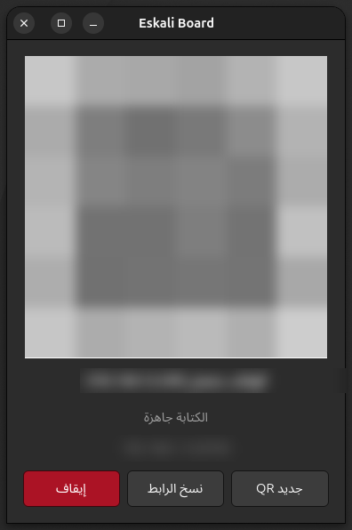
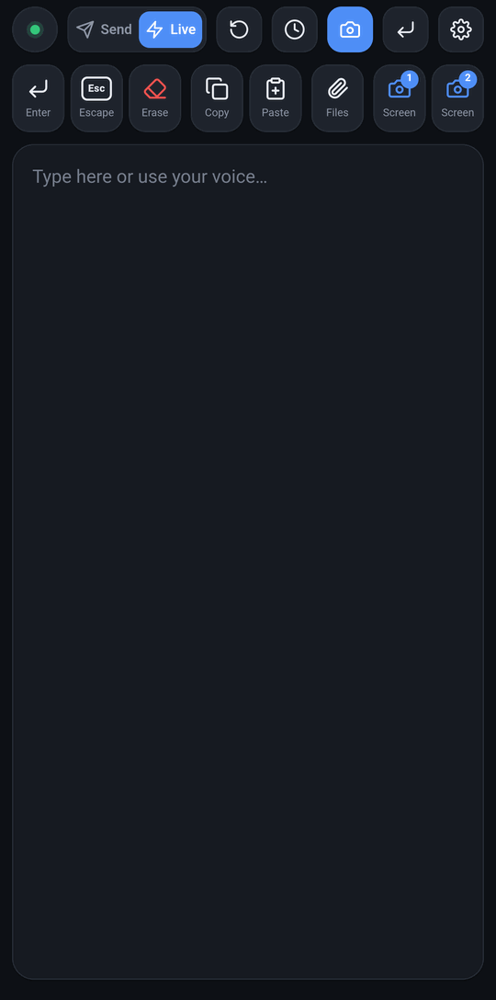
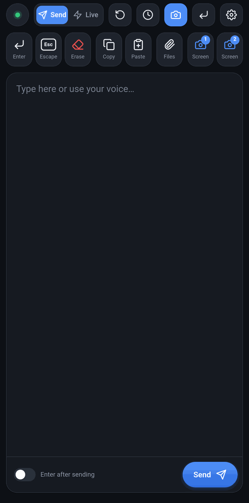
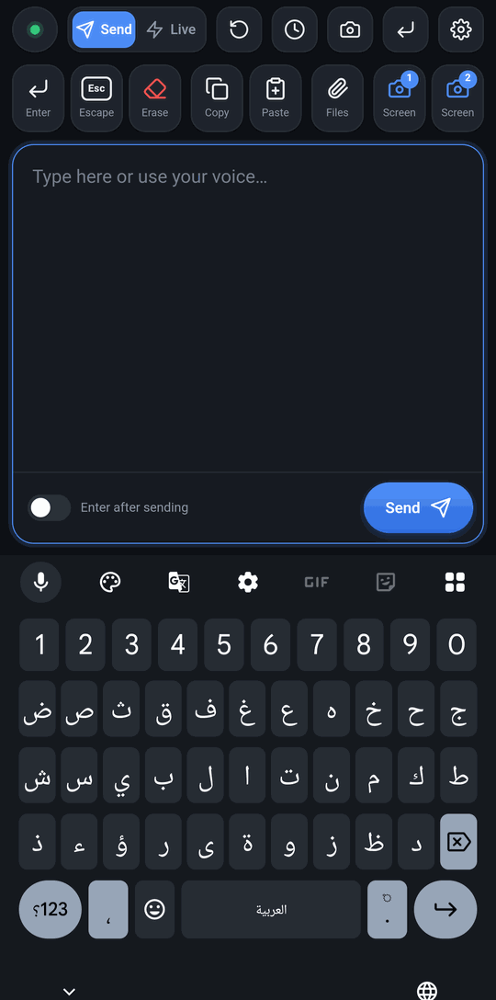

<div align="center">

[English](README.md) · [Français](README.fr.md) · **العربية**


# Eskali Board

**هاتفك يصبح لوحة مفاتيح لحاسوبك.**
امسح رمز QR، ثم اكتب أو أملِ على الهاتف بالعربية أو الفرنسية أو الإنجليزية، فيظهر النص في النافذة النشطة على الحاسوب.

[](LICENSE)
[](requirements.txt)
[](#systems)
[](https://github.com/Mohamedeskali/EskaBoard/actions/workflows/android.yml)
[](https://github.com/Mohamedeskali/EskaBoard/releases)

[التثبيت](#install) · [الاستعمال](#usage) · [تطبيق أندرويد](#android) · [الأمان](#security) · [حل المشاكل](#troubleshooting)

</div>

---

<p align="center">
  
  
  
  
</p>

<p align="center"><sub>نافذة الحاسوب (رمز QR مخفي) · الوضع المباشر · وضع الإرسال · الكتابة بالعربية عبر Gboard</sub></p>

<!-- فيديو توضيحي (قريبًا): put the link or a thumbnail here, e.g.
[](https://youtu.be/...)
-->

<div dir="rtl">

## المحتويات

- [المميزات](#features)
- [الأنظمة المدعومة](#systems)
- [البدء السريع](#quick-start)
- [المتطلبات](#requirements)
- [أسئلة شائعة](#faq)
- [التثبيت](#install) ([أوبونتو](#install-ubuntu)، [ويندوز](#install-windows)، [من مجلد](#from-folder))
- [الاستعمال](#usage)
- [تطبيق أندرويد](#android)
- [الأمان والخصوصية](#security)
- [كيف يعمل](#how-it-works)
- [الحدود](#limitations)
- [حل المشاكل](#troubleshooting)
- [التطوير](#development)
- [الرخصة](#license)

<a id="features"></a>
## المميزات

- **اكتب وأملِ من الهاتف.** استعمل لوحة مفاتيح الهاتف (الكتابة الصوتية في Gboard، الكتابة بالسحب، التصحيح التلقائي) وأرسل النص إلى الحاسوب.
- **العربية تعمل في كل مكان.** يصل النص من اليمين إلى اليسار سليمًا إلى الحاسوب، مهما كان تخطيط لوحة المفاتيح المفعّل فيه.
- **وضعان.** **مباشر** ينقل كل حرف لحظة كتابته؛ **إرسال** يرسل النص كله دفعة واحدة، ويمكن أن يتبعه Enter.
- **أزرار سريعة.** إدخال، إلغاء (Esc)، مسح ما كتبه الهاتف، نسخ، لصق.
- **لقطات شاشة للحاسوب** (زر لكل شاشة)، تُحفظ وتوضع في حافظة الحاسوب.
- **إرسال الصور والملفات** من الهاتف إلى مجلد `التنزيلات/EskaBoard` في الحاسوب.
- **سجل النصوص.** كل نص يخرج من الخانة يُحفظ في الهاتف: استرجعه أو أعد إرساله أو احذفه.
- **تطبيق أندرويد اختياري** فيه ماسح QR، وملء الشاشة، وزرّان عائمان (Enter ولقطة الشاشة) يعملان فوق كل التطبيقات.
- **بلا حساب وبلا سحابة.** يتصل الهاتف والحاسوب مباشرة عبر شبكة Wi-Fi الخاصة بك، بتشفير من طرف إلى طرف.
- **ثلاث لغات** لصفحة الهاتف وللتطبيق: العربية، English، Français.

<a id="systems"></a>
## الأنظمة المدعومة

| الحاسوب | ملاحظات |
|---|---|
| أوبونتو 24.04 أو أحدث | واجهة GNOME على Wayland |
| ويندوز 10 و 11 | منذ الإصدار 0.2.0 |

لا يحتاج الهاتف إلا إلى متصفح، ويجب أن يكون على **نفس شبكة Wi-Fi** التي يتصل بها الحاسوب. على أندرويد يمكنك أيضًا استعمال [تطبيق Eskali Board](#android) (أندرويد 7.0 أو أحدث).

<a id="quick-start"></a>
## البدء السريع

1. **ثبّت** Eskali Board على الحاسوب بأمر واحد ([أوبونتو](#install-ubuntu) أو [ويندوز](#install-windows)).
2. **افتحه**: يظهر رمز QR.
3. **امسح** رمز QR بالهاتف (نفس الـ Wi-Fi)، انقر في أي نافذة على الحاسوب، واكتب.

هذا كل شيء: لا حساب، لا رمز اقتران تكتبه، ولا شيء تثبّته على الهاتف.

<a id="requirements"></a>
## المتطلبات

| أين | ما تحتاجه |
|---|---|
| حاسوب أوبونتو | أوبونتو 24.04 أو أحدث مع GNOME على Wayland، والحزم `python3-venv python3-gi gir1.2-gtk-4.0` (يتحقق منها المثبّت ويعرض أمر `apt` إن نقصت واحدة) |
| حاسوب ويندوز | ويندوز 10 أو 11 و PowerShell (موجود في النظام). يُثبَّت Python 3 تلقائيًا عبر `winget` إن لم يكن موجودًا |
| الهاتف | أي هاتف فيه متصفح حديث (أندرويد أو آيفون)، على نفس شبكة Wi-Fi التي يتصل بها الحاسوب |
| تطبيق أندرويد (اختياري) | أندرويد 7.0 أو أحدث |
| الشبكة | الإنترنت فقط للتحميل والتثبيت. بعد ذلك يبقى كل شيء داخل شبكتك المحلية |

<a id="faq"></a>
## أسئلة شائعة

**هل يحتاج إلى الإنترنت؟** فقط للتثبيت أو التحديث. الكتابة تعمل على الشبكة المحلية وحدها.

**هل يمر شيء عبر خادم؟** لا. الهاتف يتصل بالحاسوب مباشرة، وكل رسالة مشفرة بمفتاح لا يحمله إلا رمز QR.

**هل يمكنني استعمال آيفون؟** نعم، عبر المتصفح: امسح رمز QR بالكاميرا. التطبيق متوفر لأندرويد فقط.

**هل يمكن لهاتفين الكتابة في نفس الوقت؟** لا، هاتف واحد في كل مرة. الهاتف الثاني يأخذ مكان الأول.

**هل يعمل على macOS أو على لينكس بدون GNOME؟** ليس بعد. انظر [الحدود](#limitations).

<a id="install"></a>
## التثبيت

<a id="install-ubuntu"></a>
### أوبونتو

</div>

```bash
curl -fsSL https://raw.githubusercontent.com/Mohamedeskali/EskaBoard/main/get.sh | bash
```

<div dir="rtl">

يثبّت هذا الأمر Eskali Board في `~/EskaBoard` ويضيفه إلى قائمة التطبيقات. لا يستعمل `sudo` أبدًا: إذا نقصت حزم من النظام، يعرض أمر `apt` الذي يجب تشغيله أولًا. عند أول تشغيل، يطلب GNOME إذن "سطح المكتب البعيد": اضغط **مشاركة** (Share).

**التحديث:** أعد تشغيل نفس الأمر.

**الإزالة:**

</div>

```bash
curl -fsSL https://raw.githubusercontent.com/Mohamedeskali/EskaBoard/main/get.sh | bash -s -- --uninstall
```

<div dir="rtl">

يحذف هذا `~/EskaBoard` (مع بيئة venv)، ومدخل قائمة التطبيقات، و`~/.config/phonekb` (إذن سطح المكتب البعيد المحفوظ).

<a id="install-windows"></a>
### ويندوز

افتح **PowerShell** (من قائمة ابدأ، اكتب `PowerShell`) وشغّل:

</div>

```powershell
irm https://raw.githubusercontent.com/Mohamedeskali/EskaBoard/main/get.ps1 | iex
```

<div dir="rtl">

يثبّت هذا الأمر Eskali Board في `%LOCALAPPDATA%\EskaBoard`، ويثبّت Python عبر `winget` إن لم يكن موجودًا، ويضيف Eskali Board إلى قائمة ابدأ وسطح المكتب، ثم يشغّله. تُفتح صفحته في المتصفح مع رمز QR. لا حاجة لصلاحيات المسؤول.

في المرة الأولى، يسأل جدار حماية ويندوز هل يُسمح لـ Python باستعمال الشبكة: فعّل **الشبكات الخاصة** (Private networks) واضغط **سماح** (Allow). إذا كانت شبكة Wi-Fi عندك من نوع **عامة** (Public)، ينبّهك المثبّت؛ انظر [حل المشاكل](#troubleshooting-windows).

**التحديث:** أعد تشغيل نفس الأمر.

**الإزالة:**

</div>

```powershell
& ([scriptblock]::Create((irm https://raw.githubusercontent.com/Mohamedeskali/EskaBoard/main/get.ps1))) -Uninstall
```

<div dir="rtl">

يحذف هذا `%LOCALAPPDATA%\EskaBoard` (مع venv)، واختصارات قائمة ابدأ وسطح المكتب، و`%APPDATA%\EskaBoard` (ملف السجل)، ثم يعرض ما حذفه. يبقى Python وأي قاعدة جدار حماية أنشأها ويندوز له.

<a id="from-folder"></a>
### من مجلد

بدون الأمر ذي السطر الواحد (مثلًا من ملف ZIP للمشروع):

</div>

```bash
# Ubuntu
./install.sh              # creates venv/ if missing, adds Eskali Board to the apps menu
./install.sh --uninstall  # removes the menu entry and icon (keeps the folder and venv)
```

```powershell
# Windows: extract the ZIP, open PowerShell in the extracted folder
powershell -ExecutionPolicy Bypass -File .\install.ps1              # install and start
powershell -ExecutionPolicy Bypass -File .\install.ps1 -Uninstall   # remove shortcuts, settings and the folder
```

<div dir="rtl">

تشير الاختصارات إلى مكان المجلد. إذا نقلته أو غيّرت اسمه، أعد تشغيل سكربت التثبيت.

<a id="usage"></a>
## الاستعمال

1. افتح Eskali Board من قائمة التطبيقات (أوبونتو) أو من قائمة ابدأ (ويندوز).
2. امسح رمز QR بكاميرا الهاتف (أو بـ[تطبيق أندرويد](#android)).
3. انقر في نافذة الحاسوب التي تريد أن يصل إليها النص، ثم اكتب على الهاتف.

### على الحاسوب

يعرض أوبونتو نافذة، ويعرض ويندوز صفحة في المتصفح. في الحالتين تجد رمز QR وحالة الاتصال وثلاثة أزرار:

| الزر | وظيفته |
|---|---|
| **QR جديد** | ينشئ رابطًا جديدًا؛ الهاتف الذي يستعمل الرابط القديم يُفصل |
| **نسخ الرابط** | ينسخ رابط رمز QR، لاستعماله في [تطبيق أندرويد](#android) |
| **إيقاف** | يوقف Eskali Board |

على ويندوز يمكنك إغلاق الصفحة: يبقى Eskali Board شغالًا. افتحه من قائمة ابدأ لترى الصفحة من جديد.

### على الهاتف

**الشريط العلوي**

| الزر | وظيفته |
|---|---|
| **إرسال** | اكتب أولًا، ثم أرسل كل شيء دفعة واحدة (فعّل **Enter بعد الإرسال** ليُضغط Enter بعده) |
| **مباشر** | يظهر النص على الحاسوب أثناء الكتابة أو الإملاء |
| **🌐** | لغة الصفحة: العربية أو English أو Français. تتبع لغة الهاتف ما لم تختر واحدة |
| **↺** (جديد) | يفرغ الخانة دون حذف أي شيء من الحاسوب |
| **🕘** (السجل) | النصوص التي خرجت من الخانة، من الأحدث إلى الأقدم: استرجاع، إعادة إرسال، حذف، أو مسح الكل |

**الأزرار السريعة**

| الزر | وظيفته |
|---|---|
| **إدخال** / **إلغاء** | ضغط Enter و Esc على الحاسوب |
| **مسح** | يحذف من الحاسوب ما كتبه الهاتف منذ آخر زر سريع، ويفرغ الخانة. يُحذف نص الهاتف فقط، ولا يُمس باقي المستند |
| **نسخ** / **لصق** | نسخ (Ctrl+C) ولصق (Ctrl+V) على الحاسوب |
| **ملفات** | يرسل صورًا أو ملفات إلى الحاسوب، في `التنزيلات/EskaBoard` |
| **📷 1**، **📷 2**… | لقطة لكل شاشة من شاشات الحاسوب، من اليسار إلى اليمين. تُحفظ في `الصور/لقطات الشاشة` وتوضع في حافظة الحاسوب، جاهزة لـ Ctrl+V أو **لصق** |

عند ضغط Enter (زر الإدخال في الصفحة، أو زر Enter في لوحة مفاتيح الهاتف والمؤشر في آخر النص) تُفرَغ الخانة بعد وصول النص إلى الحاسوب، ليبدأ النص التالي من جديد. ويبقى النص محفوظًا في السجل.

### نصيحة: ترجمة فورية

مع Gboard يمكنك أن تكتب بلغة ويصل النص إلى الحاسوب بلغة أخرى، دون تثبيت أي شيء إضافي:

1. في صفحة Eskali Board، المس خانة النص ليفتح Gboard.
2. في شريط أدوات Gboard، المس **ترجمة** (افتح قائمة **⋯** إن لم يظهر).
3. اختر اللغتين، مثلًا **العربية ← الفرنسية**.
4. اكتب في خانة الترجمة في Gboard: يذهب النص المترجم إلى الصفحة ثم إلى الحاسوب، في الوضعين.

الترجمة يقوم بها Gboard على الهاتف، لذلك تتوقف على اللغات التي يدعمها.

<a id="android"></a>
## تطبيق أندرويد

يفتح تطبيق Eskali Board نفس الصفحة بملء الشاشة، بدون شريط عنوان المتصفح، ويضيف أزرارًا عائمة. وهو اختياري: كاميرا الهاتف والمتصفح يؤديان نفس المهمة.

**التثبيت:** حمّل `EskaBoard.apk` من صفحة [الإصدارات](https://github.com/Mohamedeskali/EskaBoard/releases) على الهاتف وافتحه. في المرة الأولى، يطلب أندرويد السماح بتثبيت التطبيقات من المتصفح (أو مدير الملفات). يتطلب أندرويد 7.0 أو أحدث.

افتح التطبيق ثم:
- **امسح رمز QR** بالماسح المدمج (يطلب إذن الكاميرا مرة واحدة)، أو
- **الصق الرابط**: اضغط **نسخ الرابط** على الحاسوب، وأوصل الرابط إلى الهاتف (مثلًا في محادثة مع نفسك)، والصقه في التطبيق. يمكنك أيضًا **مشاركة** الرابط من تطبيق دردشة إلى Eskali Board.

يتذكر التطبيق آخر حاسوب: زر **إعادة الاتصال** يفتحه من جديد ما دام Eskali Board شغالًا عليه. إذا أُعيد تشغيل Eskali Board، أو ضُغط **QR جديد**، أو لم يتصل أي هاتف لمدة 30 دقيقة، يخبرك التطبيق أن الرمز انتهت صلاحيته: امسح الرمز الجديد.

كتابة عنوان IP وحده لا تكفي: الرمز (token) والمفتاح يتغيران مع كل تشغيل لـ Eskali Board، والحاسوب يرفض الهاتف بدونهما.

### الإعدادات

الترس (في شاشة البداية وأعلى الصفحة) يفتح إعدادات التطبيق:
- **اللغة**: تلقائية (لغة الهاتف)، العربية، Français أو English. يتغير التطبيق والصفحة فورًا.
- **أزرار الصفحة**: إظهار أو إخفاء كل زر في شريط الأدوات.
- **الأزرار العائمة** (معطلة افتراضيًا): انظر أدناه.

### الأزرار العائمة

أزرار دائرية تطفو فوق كل التطبيقات، ويمكنك سحبها إلى أي مكان. فعّلها من الإعدادات أو من الشريط العلوي للصفحة. يطلب أندرويد إذن **الظهور فوق التطبيقات الأخرى** (وللقطات، إذن **تسجيل الشاشة**: اختر الشاشة كاملة وليس تطبيقًا واحدًا). يبقى إشعار ظاهرًا ما دام زر ظاهرًا؛ أطفئه من الإعدادات أو بزر **إيقاف** في الإشعار.

- **Enter**: يضغط Enter على الحاسوب من أي تطبيق، عبر الاتصال المشفر للصفحة.
- **لقطة الشاشة**: يلتقط شاشة الهاتف (بدون الزر) وينسخها إلى **حافظة الهاتف**. إذا كانت الصفحة متصلة، تذهب اللقطة أيضًا إلى **الحاسوب**: إلى حافظته (Ctrl+V) وإلى `الصور/لقطات الشاشة` (`Screenshot … phone.png`). قد يوقف أندرويد التسجيل من تلقاء نفسه (مثلًا بزر "إيقاف المشاركة")؛ فعّله من جديد في الإعدادات.

<a id="security"></a>
## الأمان والخصوصية

- **محلي فقط.** يتصل الهاتف والحاسوب مباشرة عبر شبكتك. لا خادم ولا حساب ولا إحصائيات ولا خدمة سحابية.
- **تشفير من طرف إلى طرف.** كل تشغيل ينشئ رمزًا عشوائيًا (`?t=`) ومفتاحًا من 32 بايت (`#k=`) داخل رابط QR. المفتاح في جزء الـ fragment من الرابط، لذلك لا يمر أبدًا عبر الشبكة. كل رسالة WebSocket مشفرة بـ NaCl secretbox، مع معرّف جلسة وعدّاد: النص غير المشفر، والمفتاح الخاطئ، والرسائل المُعادة كلها مرفوضة.
- **حماية من التخمين.** 5 رموز خاطئة من نفس عنوان IP تحظره لمدة 60 ثانية.
- **الروابط تنتهي صلاحيتها.** بعد 30 دقيقة بدون هاتف متصل (`--expire`)، وعند **QR جديد**، ومع كل إعادة تشغيل.
- **الصور المستلمة يُعاد ترميزها.** لا يقبل الحاسوب إلا لقطات PNG (حتى 16 ميغابايت و40 ميغابكسل)، يفك ترميزها ويعيد ترميزها قبل حفظها.
- **الملفات تُكتب بأمان.** كل ملف يُكتب في ملف مخفي `.part` ولا يأخذ اسمه إلا بعد وصول كل البايتات (حتى 500 ميغابايت للملف).

> [!WARNING]
> الرابط (و`qr.png` في وضع الطرفية) يحتوي على رمز الاقتران ومفتاح التشفير: أي شخص يملكه وهو على نفس شبكة Wi-Fi يستطيع الكتابة على حاسوبك حتى تضغط **QR جديد** أو تعيد تشغيل Eskali Board. لا تنشره في أي مكان عام. سجل حافظة ويندوز (Win+V) يحتفظ بما تنسخه.

<a id="how-it-works"></a>
## كيف يعمل

</div>

```
 Phone (browser or app)                       PC (Python, aiohttp)
┌─────────────────────┐   encrypted       ┌──────────────────────────────┐
│ phone page          │   WebSocket       │ server.py  token / IP checks │
│ Gboard, voice, keys │ ───────────────►  │ typing worker                │
│ tweetnacl (local)   │   same Wi-Fi      │  ├─ Ubuntu: GNOME portal     │
└─────────────────────┘                   │  └─ Windows: SendInput       │
                                          └──────────────────────────────┘
```

<div dir="rtl">

- **أوبونتو:** تمر الكتابة عبر بوابة "سطح المكتب البعيد" في GNOME. يوضع النص في الحافظة عبر البوابة ثم يُلصق بـ Ctrl+V؛ ينتظر البرنامج حتى يقرأه التطبيق، ثم يعيد ما كنت قد نسخته (نصًا أو صورة) بعد ثانية من توقفك عن الكتابة. الأزرار الخاصة تُرسل كضغطات مفاتيح. يُحفظ رمز الإذن في `~/.config/phonekb/restore_token`، لذلك تظهر نافذة الإذن مرة واحدة فقط.
- **ويندوز:** يُكتب النص كحروف Unicode عبر `SendInput`، فتعمل العربية مهما كان تخطيط لوحة المفاتيح، ولا تُستعمل الحافظة (إلا للقطات الشاشة). صفحة رمز QR تُقدَّم على `127.0.0.1` فقط، على منفذ عشوائي، وخلف سر عشوائي موجود في العنوان الذي يفتحه المتصفح؛ لا يمكن الوصول إليها من الشبكة.
- **البقاء متصلًا:** عندما يعود الهاتف من تطبيق آخر أو من شاشة القفل، تتحقق الصفحة من اتصالها (ping مشفر) وتعيد الاتصال وحدها بنفس الرابط. كل اتصال يأخذ معرّف جلسة جديدًا من الحاسوب ويبدأ عدّاده من الصفر، فلا يُقبل أي شيء أُرسل في اتصال سابق. ويرسل الحاسوب أيضًا ping للهاتف كل 20 ثانية ويفصل الهاتف الذي توقف عن الرد.

<a id="limitations"></a>
## الحدود

- أبقِ النافذة المستهدفة نشطة أثناء الكتابة.
- هاتف واحد في كل مرة. الصفحة التي حل محلها هاتف آخر (أو تبويب آخر) تستعيد التحكم عندما تظهر من جديد، أو عند لمس تنبيهها.
- أوبونتو: GNOME على Wayland فقط. الطرفيات تلصق بـ Ctrl+Shift+V، لذلك قد لا تعمل الكتابة في الطرفية، وفيها يوقف **نسخ** (Ctrl+C) الأمر الجاري بدل النسخ. لا يُستعاد من الحافظة بعد الكتابة إلا النص وصور PNG. لقطات الشاشة تمر عبر بوابة لقطات الشاشة في GNOME، وقد تطلب إذنًا في المرة الأولى.
- ويندوز: لا يمكن الكتابة في البرامج التي تعمل بصلاحيات المسؤول (ويندوز يمنع ذلك)، ولا في شاشة القفل ونوافذ UAC. بعض البرامج التي تقرأ المفاتيح الخام (بعض الألعاب وأدوات سطح المكتب البعيد) تتجاهل الكتابة بـ Unicode.

<a id="troubleshooting"></a>
## حل المشاكل

### أوبونتو

- **لا تظهر نافذة الإذن:** قد تكون خلف نوافذ أخرى (Alt+Tab)، وتتوقف بعد 5 دقائق.
- **سحب الإذن:** احذف `~/.config/phonekb` (إعدادات GNOME ليس فيها صفحة لذلك). الإزالة تفعل هذا تلقائيًا.
- **النص لا يظهر:** تأكد أن النافذة المستهدفة نشطة، وانظر إلى مخرجات الطرفية.
- **الهاتف يقول إن رمز QR انتهى:** أُعيد تشغيل Eskali Board، أو ضُغط **QR جديد**، أو لم يتصل أي هاتف لمدة 30 دقيقة. امسح الرمز الجديد.

<a id="troubleshooting-windows"></a>
### ويندوز

- **سؤال جدار الحماية.** في المرة الأولى يسأل ويندوز هل يُسمح لـ "Python" باستعمال الشبكة. فعّل **الشبكات الخاصة** واضغط **السماح بالوصول** (الحساب العادي يطلب كلمة مرور المسؤول). إذا ضغطت **إلغاء**، لن يستطيع الهاتف الاتصال: ابدأ، اكتب `Allow an app through Windows Firewall`، ثم **تغيير الإعدادات**، وفعّل **خاص** لكل مدخل **Python**، ثم **موافق**. ينبّهك المثبّت إذا وجد قاعدة حظر من هذا النوع. Eskali Board لا يغيّر جدار الحماية بنفسه أبدًا.
- **الشبكة "العامة" تمنع الهاتف.** يمنع ويندوز الاتصالات الواردة على الشبكات العامة، حتى بعد السماح لـ Python. إذا كانت شبكة منزلك أو عملك، اجعلها خاصة: **الإعدادات > الشبكة والإنترنت > Wi-Fi** (أو **Ethernet**) > شبكتك > **نوع ملف تعريف الشبكة: خاص**. افعل ذلك فقط مع الشبكات التي تثق بها. ينبّهك المثبّت عندما تكون الشبكة عامة.
- **نفس الـ Wi-Fi.** يجب أن يكون الهاتف على نفس شبكة Wi-Fi التي يتصل بها الحاسوب، لا على بيانات الهاتف ولا على شبكة ضيوف (شبكات الضيوف غالبًا تعزل الأجهزة). العنوان تحت رمز QR (مثلًا `192.168.1.20:8765`) يجب أن يبدأ مثل عنوان Wi-Fi الهاتف. شبكة VPN على الحاسوب قد تجعل Eskali Board يختار عنوانًا خاطئًا: أطفئها، أو شغّله مع `--host` وعنوان Wi-Fi الحاسوب.
- **"تشغيل السكربتات معطّل على هذا النظام".** الأمر `irm ... | iex` لا يتأثر. بالنسبة لـ `install.ps1` من ملف ZIP، شغّله كما في [من مجلد](#from-folder) مع `-ExecutionPolicy Bypass`: هذا يسمح به لهذا التشغيل فقط ولا يغيّر أي إعداد.
- **SmartScreen / "هذا الملف من الإنترنت".** ليس لـ Eskali Board ملف `.exe`. إذا حذّرك المتصفح من ملف ZIP، اختر **الاحتفاظ**. إذا منع ويندوز السكربتات المستخرجة، انقر بالزر الأيمن على ملف ZIP، ثم **خصائص**، وفعّل **إلغاء الحظر**، ثم استخرجه من جديد (أو شغّل `Unblock-File .\install.ps1`).
- **أُغلقت الصفحة.** يبقى Eskali Board شغالًا: افتحه من قائمة ابدأ لترى الصفحة من جديد.
- **النص لا يظهر.** تأكد أن النافذة المستهدفة نشطة ولا تعمل بصلاحيات المسؤول. السجل موجود في `%APPDATA%\EskaBoard\eskaboard.log`.
- **"Port 8765 is in use".** نسخة أخرى من Eskali Board، أو برنامج آخر، يستعمل المنفذ. أوقفه، أو شغّل Eskali Board مع `--port 8766`.

<a id="development"></a>
## التطوير

### التشغيل من الطرفية

</div>

```bash
venv/bin/python3 -m phonekb          # Ubuntu: QR code in the terminal (also saved as qr.png)
venv/bin/python3 -m phonekb --gui    # Ubuntu: the window
venv\Scripts\python -m phonekb       # Windows: QR code in the terminal
venv\Scripts\python -m phonekb --gui # Windows: the page in the browser
```

<div dir="rtl">

| الخيار | المعنى |
|---|---|
| `--host IP` | عنوان الحاسوب الذي يوضع في رمز QR (افتراضيًا: عنوان الشبكة المحلية، يُكتشف تلقائيًا) |
| `--port N` | المنفذ (8765 افتراضيًا) |
| `--dry-run` | يسجّل الرسائل دون أن يكتب شيئًا (لا يحتاج البوابة) |
| `--expire MIN` | تنتهي صلاحية الرابط بعد MIN دقيقة بدون هاتف متصل (30 افتراضيًا، 0: أبدًا) |
| `--gui` | النافذة (أوبونتو) أو الصفحة في المتصفح (ويندوز) |
| `--version` | يعرض رقم الإصدار |

### الاختبارات

</div>

```bash
venv/bin/python3 -m unittest discover -s tests      # PC: reconnect, replay, expiry, live mode, files, images
cd android && ./gradlew testDebugUnitTest            # Android unit tests
```

<div dir="rtl">

### بناء تطبيق أندرويد

يبني GitHub Actions ملف APK (`.github/workflows/android.yml`) عند كل تغيير في `android/` ومع كل إصدار منشور، ويرفق به `EskaBoard.apk`. يبقى ملف APK أيضًا قابلًا للتحميل من صفحة تشغيل الـ workflow. لبنائه على الحاسوب، مع JDK 17 و Android SDK: `cd android && ./gradlew assembleDebug`.

لا يثبّت أندرويد تحديثًا إلا إذا كان موقّعًا بنفس مفتاح التطبيق المثبّت. بدون مفتاح، كل بناء في CI يوقَّع بمفتاح مؤقت، ويجب حذف التطبيق القديم أولًا. لتوقيع كل البناءات بنفس المفتاح، أنشئ مفتاحًا مرة واحدة (`keytool` يأتي مع Java):

</div>

```bash
keytool -genkeypair -keystore eskaboard.jks -alias eskaboard -keyalg RSA -keysize 2048 -validity 10000 -dname "CN=EskaBoard"
base64 -w0 eskaboard.jks   # Windows PowerShell: [Convert]::ToBase64String([IO.File]::ReadAllBytes("eskaboard.jks"))
```

<div dir="rtl">

بعد ذلك، في **Settings > Secrets and variables > Actions** في المستودع، أضف `ANDROID_KEYSTORE_BASE64` (نص base64)، و`ANDROID_KEYSTORE_PASSWORD`، و`ANDROID_KEY_ALIAS` (`eskaboard`)، و`ANDROID_KEY_PASSWORD` (نفس كلمة المرور). احتفظ بـ `eskaboard.jks` وكلمة مروره في مكان آمن: بدونهما لا يمكن تثبيت أي تحديث فوق التطبيق.

### بنية المشروع

انظر [Project layout](README.md#project-layout) في النسخة الإنجليزية.

### الفروع

- `main`: النسخة المستقرة (التي تحمّلها أوامر التثبيت).
- `recette`: التطوير والاختبار. كل عمل جديد يبدأ من `recette` وطلبات الدمج (pull requests) تستهدفه؛ ويُدمج في `main` بعد اختباره.

<a id="license"></a>
## الرخصة

MIT، انظر [LICENSE](LICENSE). © 2026 Mohamed Eskali.

الملف `phonekb/static/nacl-fast.min.js` هو [TweetNaCl.js](https://github.com/dchest/tweetnacl-js) 1.0.3 من مساهمي TweetNaCl.js، وهو في الملك العام (The Unlicense).

</div>
